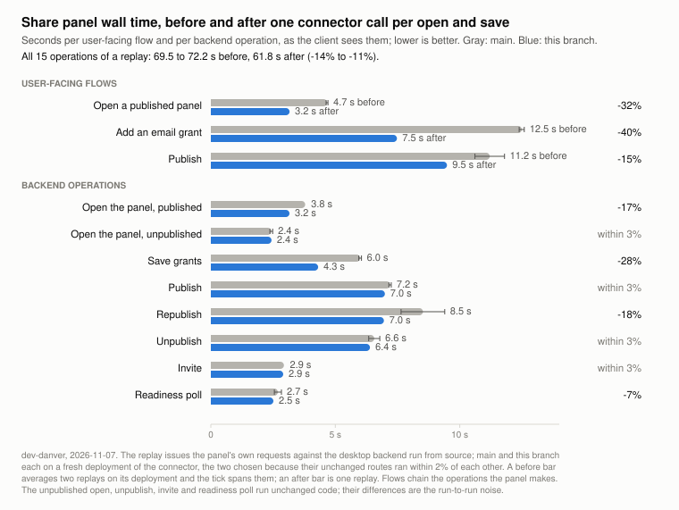

# Share panel: one connector call per open and save

The share panel used to make three or four Imbue Cloud round trips for every open and
save: a status read, the grants push, a separate grantee push, and a separate
invitation-outcomes read (also after every invite). Each round trip costs a
`mngr imbue_cloud` subprocess launch plus the connector's per-request overhead, which
is about 0.6 s on a dev tier even for a trivial route. The grants push is now the one
call: it mirrors the granted accounts itself and answers the share's status, the
invitation outcomes, and the grantees' identities, so an open of a published panel
and a save each make one call, and the panel takes the outcomes from the sharing
document (see the `inviting-granted-visitors` spec, sections 8 and 9).

## What it saved

Measured on a dev tier on 2026-11-07 with a replay that issues the panel's own requests
(38 before, 30 after) against the desktop backend run from source, main against the
change, each on its own fresh deployment of the connector. A deployment's per-request
speed varies by up to 1.5x with where its containers land, which is larger than the
effect, so the comparison is the pair of deployments whose unchanged routes ran within
2% of each other; the before column spans two replays on that deployment, the after
column is one. Wall times are the backend's request spans as the client sees them.

| | before | after | change |
|---|---|---|---|
| open a published panel (flow) | 4.6 to 4.7 s | 3.2 s | -32% |
| add an email grant (flow) | 12.4 to 12.6 s | 7.5 s | -40% |
| publish (flow) | 10.6 to 11.8 s | 9.5 s | -10% to -20% |
| save grants (operation) | 5.9 to 6.1 s | 4.3 s | -27% to -29% |
| open a published panel (operation) | 3.8 s | 3.2 s | -17% |
| open an unpublished panel, unpublish, invite (operations; code paths unchanged) | | | within 3% |
| the 15 share-panel operations of a replay, total | 69.5 to 72.2 s | 61.8 s | -11% to -14% |
| connector requests / `mngr` launches in those operations | 35 / 56 | 24 / 45 | -31% / -20% |

The rewritten push takes 2.1 s instead of 0.9 s because it does the work of the three
requests it replaced; what the change saves is their per-request overhead and their
launches, not their work. Publish keeps its relay, create, and push calls, so it gains
only the outcomes read. The replay grants an email and a domain, so the identity
resolution the push now does for grants by Imbue user id is not in these numbers.
